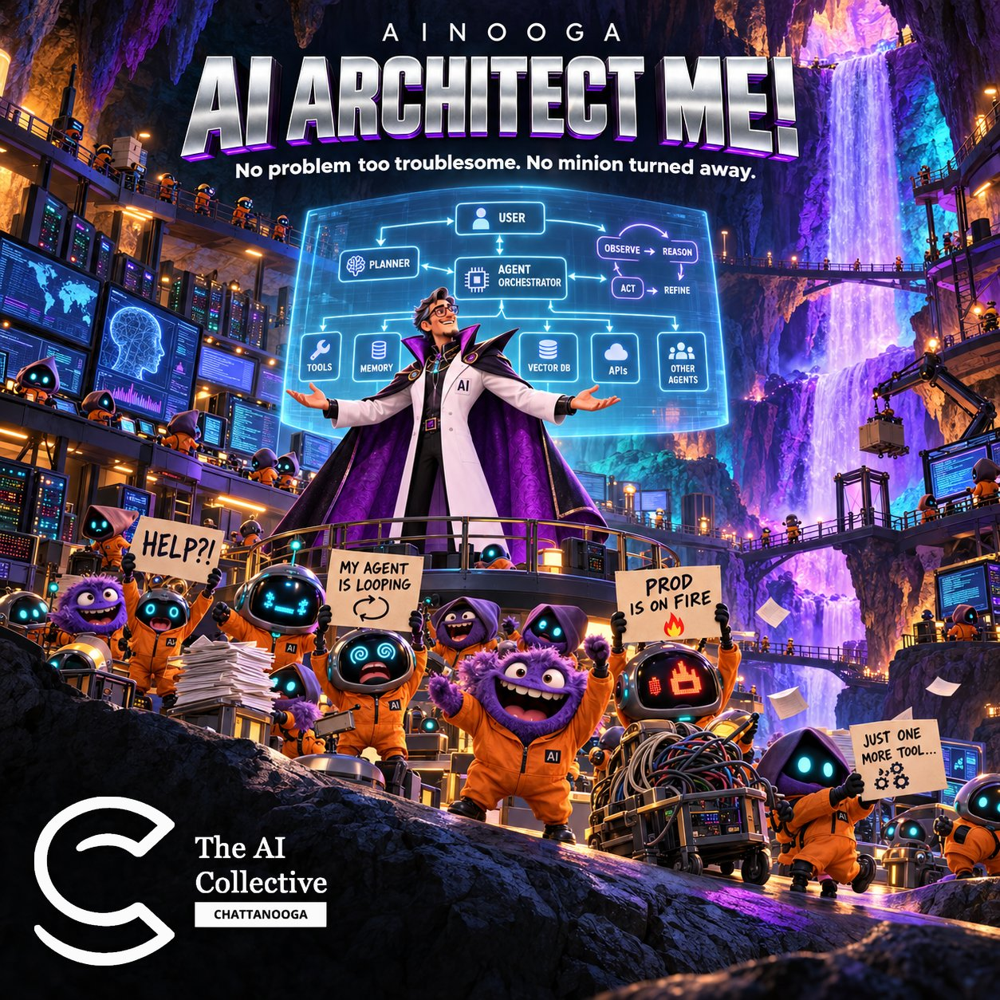
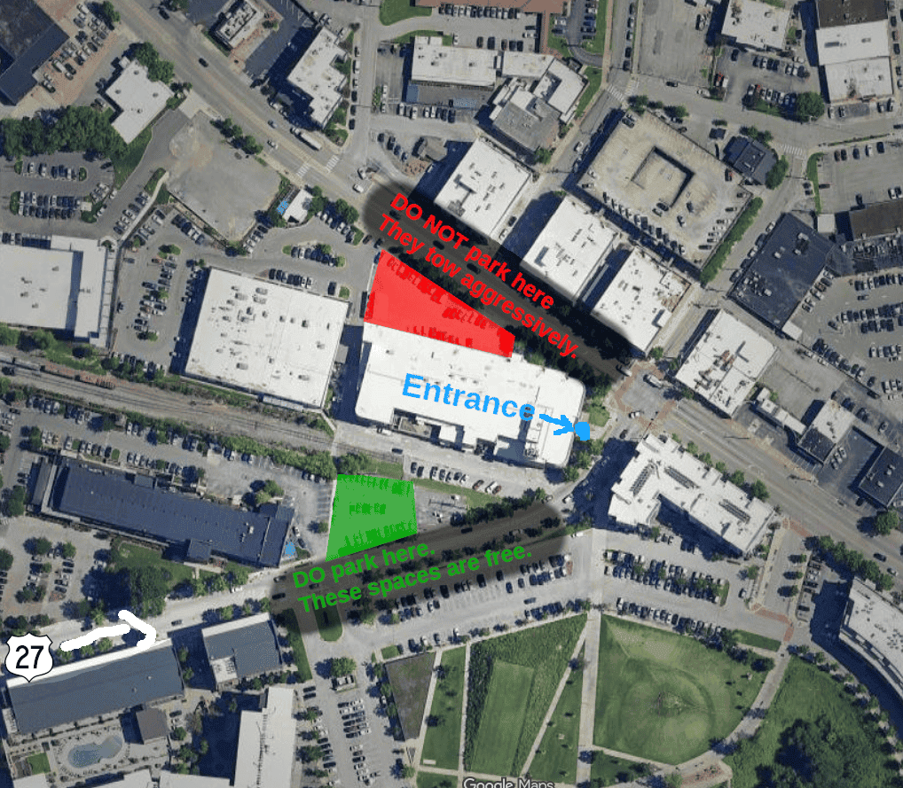

**No problem too troublesome. No minion turned away.**

Is there a task you keep meaning to automate? An agent that won't behave? A project idea you can't quite scope? Bring it.

This month is an open architecture clinic. Pitch your problem to the room, and volunteers will team up with you to design a solution: what you're trying to do, which tools fit and what the tradeoffs are. Then you'll take the first step together.

  <a href="https://luma.com/aic-ch-11-21" class="btn btn-primary" style="font-size: var(--text-lg); padding: var(--space-md) var(--space-2xl);">
    Register on Luma →
  </a>

## What We'll Do

- Settle in with food and conversation for the first 15 minutes.
- Pitch your problem to the room in a minute or two.
- Volunteers choose a problem and team up with the person who brought it.
- Teams spend the rest of the afternoon designing, building and testing.
- Wrap up with five-minute demos of what each team built or learned.

## What to Bring

A problem, whether it's big or small, technical or not. No problem of your own? Come as a volunteer and help someone else with theirs. If you want to build, bring a laptop and charger. You're also welcome to watch and ask questions, with no coding experience or laptop required.

## Location

**Business Development Center (BDC)** 
100 Cherokee Blvd., Suite 100 
Chattanooga, TN 37405

