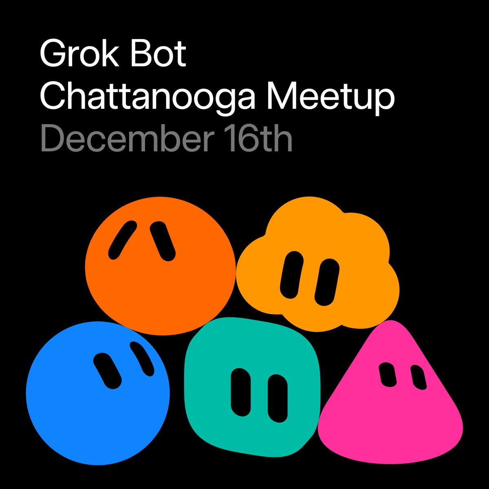

**Community event · Hosted by Will Rowston, not AI Nooga.**

Curious what Grok Bot can do in practice? Will Rowston is hosting a free, beginner-friendly meetup with a live demo, examples of how people use the bot at work and at home, and time for questions and networking. No coding experience required. Laptop optional.

**Wednesday, December 16, 2026 · 6–8 p.m. ET**

  <a href="https://luma.com/xoi05vfx" class="btn btn-primary" style="font-size: var(--text-lg); padding: var(--space-md) var(--space-2xl);">
    RSVP on Luma →
  </a>

