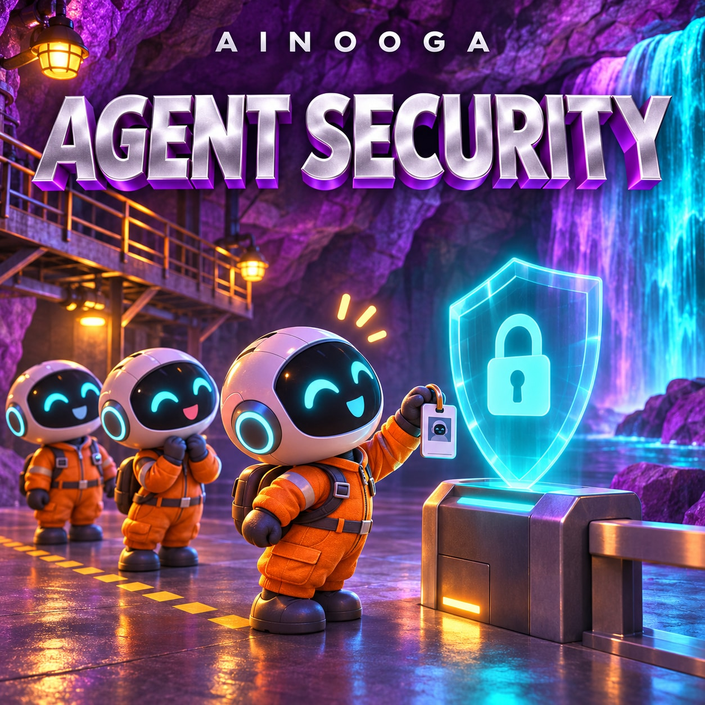
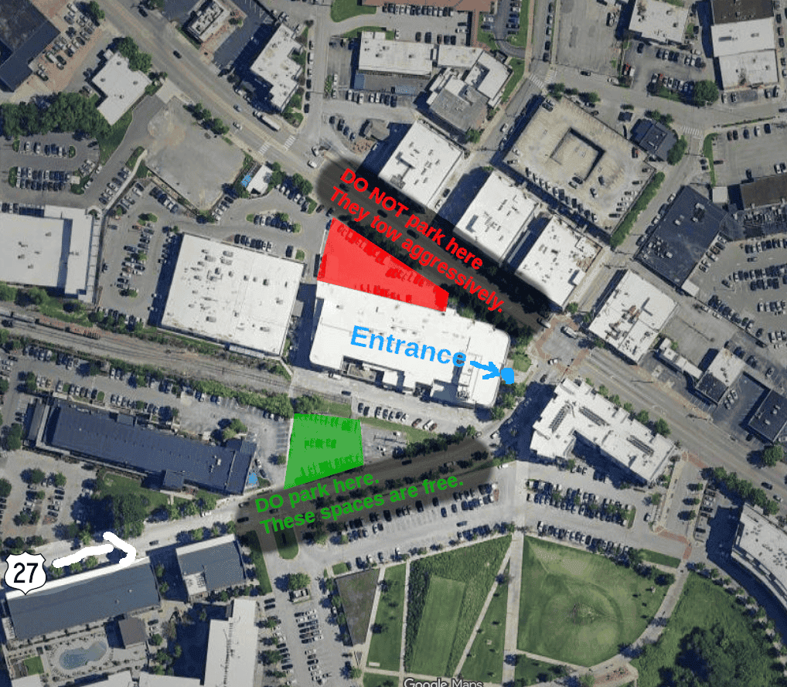

**Save the date: Saturday, December 19, 2026, 1–5 p.m. ET.**

What should an AI agent be allowed to do on your behalf? That’s the theme of AI Nooga’s December meetup. We’ll announce the specific talk topic and speaker once they’re confirmed.

  <a href="https://luma.com/aic-ch-12-19" class="btn btn-primary" style="font-size: var(--text-lg); padding: var(--space-md) var(--space-2xl);">
    Register on Luma →
  </a>

## Location

**Business Development Center (BDC)** 
100 Cherokee Blvd., Suite 100 
Chattanooga, TN 37405

